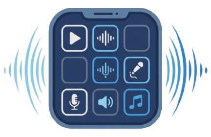
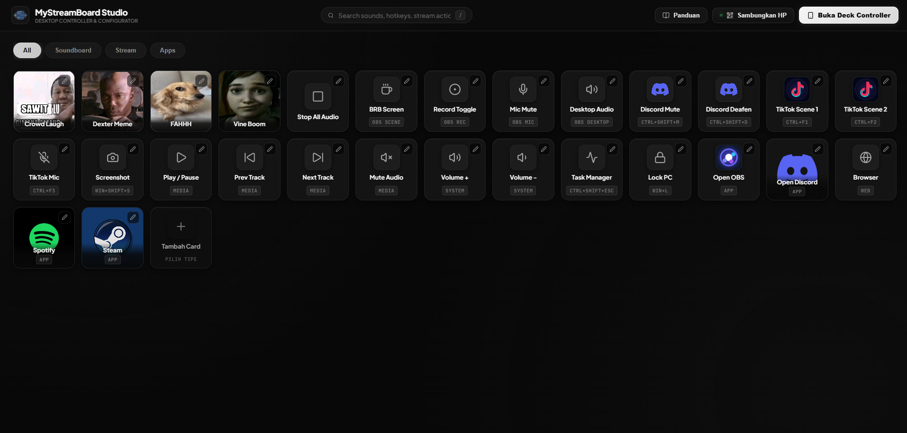
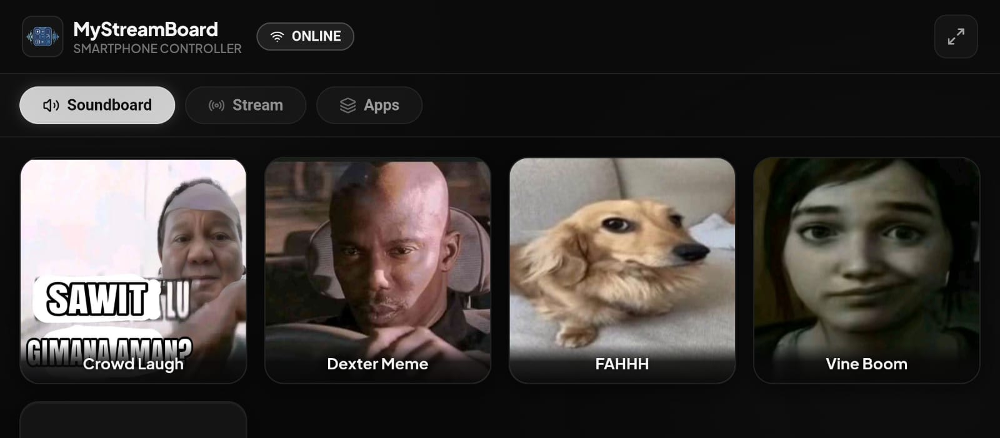
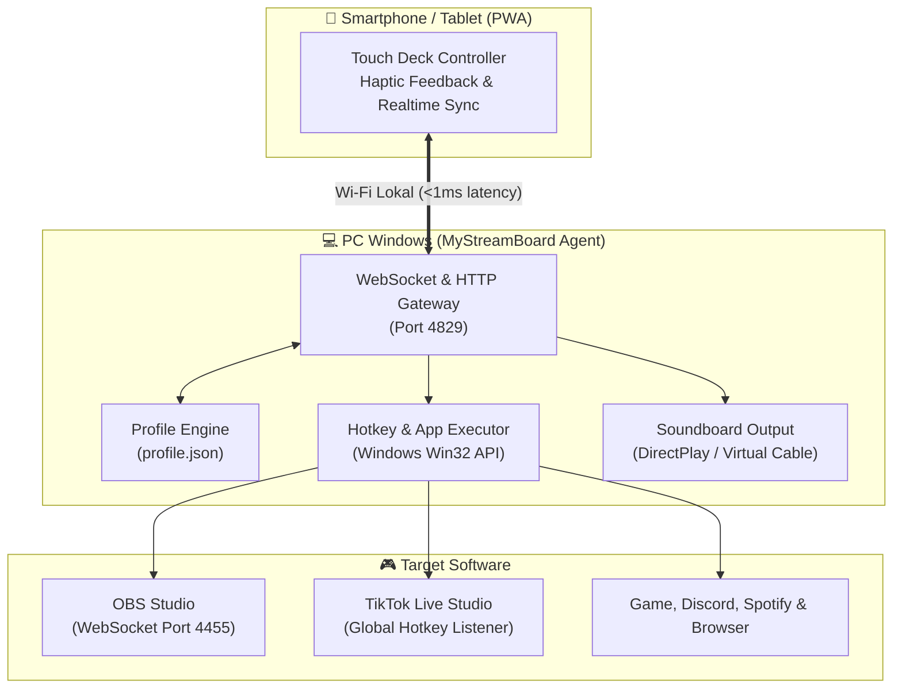

<div align="center">

  

  # ⚡ MyStreamBoard
  ### Transform Your Smartphone into a Free Professional Stream Deck & Soundboard

  [](https://github.com/DzikriAryaSahputra/mystreamboard)
  [](https://microsoft.com/windows)
  [](https://nodejs.org/)
  [](https://obsproject.com/)
  [](LICENSE)

  <p align="center">
    <strong>MyStreamBoard</strong> adalah controller stream deck & soundboard gratis berlatensi nol milidetik melalui jaringan Wi-Fi lokal.<br />
    Kendalikan <b>OBS Studio</b>, <b>TikTok Live Studio</b>, <b>Soundboard</b>, dan <b>Aplikasi Windows</b> langsung dari layar smartphone Anda.
  </p>

  <p align="center">
    <a href="#-tampilan-antarmuka-screenshots-showcase">Tampilan Layar</a> •
    <a href="#-fitur-utama">Fitur Utama</a> •
    <a href="#-panduan-instalasi--menjalankan-secara-lokal">Instalasi Cepat</a> •
    <a href="#-integrasi-streaming">Integrasi Streaming</a> •
    <a href="#-panduan-shortcut-apps--game">Shortcut Apps</a> •
    <a href="#-arsitektur-sistem">Arsitektur</a> •
    <a href="#-lisensi">Lisensi</a>
  </p>

</div>

---

## 🌟 Mengapa Memilih MyStreamBoard?

Perangkat keras stream deck fisik seringkali mahal dan memiliki jumlah tombol yang terbatas. **MyStreamBoard** memberikan pengalaman kontroler taktil kelas studio langsung di smartphone (Android / iOS) atau tablet Anda secara cuma-cuma.

| Fitur | Hardware Stream Deck Fisik | MyStreamBoard |
| :--- | :---: | :---: |
| **Biaya Perangkat** | Rp 2.000.000+ | **100% Gratis (Gunakan HP Anda)** |
| **Jumlah Tombol & Grid** | Terbatas (6 / 15 / 32 tombol) | **Tak Terbatas (Custom Multi-Page)** |
| **Koneksi & Latensi** | Kabel USB | **Wi-Fi Lokal (< 1 ms WebSocket)** |
| **OBS Studio Integration** | Perlu Plugin Tambahan | **Native WebSocket 2-Arah (Realtime Status)** |
| **TikTok Live Studio** | Konfigurasi Rumit | **Global Hotkeys Bawaan** |
| **Soundboard Player** | Terbatas | **Dual Engine + Upload Audio Bebas** |
| **Mode Layar Penuh** | - | **PWA Fullscreen (Add to Home Screen)** |

---

## 📸 Tampilan Antarmuka (Screenshots Showcase)

<div align="center">

### 🖥️ Desktop Studio Configurator
*Kelola seluruh kartu, soundboard, aksi OBS, dan hotkey aplikasi dalam antarmuka gelap stealth yang modern.*



<br/><br/>

### 📱 Smartphone Deck Controller
*Tampilan kontroler smartphone (PWA) responsif dengan sentuhan taktil (Haptic Feedback) dan latensi 0 ms melalui Wi-Fi lokal.*



</div>

---

## ✨ Fitur Utama

- 📱 **Mobile Deck Controller (PWA)**:
  - Sentuhan responsif dengan efek visual presisi saat tombol ditekan.
  - Multi-halaman terorganisir: **Soundboard**, **Stream**, dan **Apps**.
  - Pasang ke layar utama HP (*Add to Home Screen*) untuk tampilan layar penuh tanpa bar browser.

- 🔴 **Integrasi OBS Studio Realtime**:
  - Ganti Scene (*Gameplay*, *Just Chatting*, *BRB*) tanpa lag.
  - Toggle mute mikrofon dan audio desktop dengan indikator status aktif/nonaktif.
  - Mulai/hentikan rekaman video (*Record Toggle*).

- 🎵 **TikTok Live Studio & Windows Hotkeys**:
  - Simulasi kombinasi tombol global Windows tanpa jeda (*F1–F24, Ctrl, Shift, Alt, Win*).
  - Integrasi instan ke TikTok Live Studio (*Scene Switcher*, *Mute Mic*).
  - Shortcut keyboard gamer (*Discord Mute `Ctrl+Shift+M`*, *Snipping Tool `Win+Shift+S`*, *Task Manager*).

- 🔊 **Soundboard Engine Berkualitas**:
  - Dukungan format audio `MP3` dan `WAV`.
  - Kontrol volume independen tiap tombol soundboard.
  - Tombol darurat *Stop Audio* untuk menghentikan seluruh suara secara instan.

- 🖥️ **PC Studio Configurator**:
  - Tampilan *Luxury Dark Stealth Monochrome* dengan visual modern.
  - Tambah, ubah (*pencil edit*), ganti gambar kartu, dan hapus secara visual.
  - Tombol **Panduan** interaktif di navbar dengan preset cepat (*Steam, Spotify, Discord, OBS*).
  - Generator **QR Code** instan untuk menghubungkan HP dalam 1 detik.

---

## 🚀 Panduan Instalasi & Menjalankan Secara Lokal

### 1. Prasyarat Sistem
- PC / Laptop berbasis **Windows 10 / 11**.
- Telah menginstal **[Node.js](https://nodejs.org/)** (versi LTS 18.x atau yang lebih baru).
- Smartphone & PC terhubung ke **jaringan Wi-Fi yang sama**.

### 2. Langkah Clone & Menjalankan

Buka terminal (Command Prompt / PowerShell) di komputer Anda:

```bash
# 1. Clone repositori ini
git clone https://github.com/DzikriAryaSahputra/mystreamboard.git

# 2. Masuk ke direktori proyek
cd mystreamboard

# 3. Install seluruh dependensi server & client secara otomatis
npm run setup

# 4. Jalankan aplikasi MyStreamBoard
npm start
```

### 3. Sambungkan Smartphone Anda
1. Terminal akan menampilkan banner informasi beserta **QR Code**:
   ```text
   =================================================================
     ⚡ MyStreamBoard Desktop Agent v1.2.0                          
     Copyright (c) 2026 Dzikri Arya Sahputra. All rights reserved.   
   =================================================================

     🖥️  Desktop Local URL : http://localhost:4829
     📱  Mobile Deck URL  : http://192.168.1.5:4829/?mode=deck

     📲  SCAN DARI HP KAMU UNTUK LANGSUNG TERHUBUNG:
     [ QR CODE ]
   ```
2. Buka kamera smartphone Anda lalu **scan QR Code** yang muncul.
3. Tap link yang terbuka di browser HP.
4. *(Tips Profesional)* Di browser HP, tekan menu titik tiga lalu pilih **"Tambahkan ke Layar Utama" (Add to Home Screen)** agar menjadi aplikasi layar penuh layaknya Stream Deck fisik.

> **Catatan Firewall**: Jika HP Anda gagal membuka halaman, cukup klik kanan file **`izinkan-koneksi-hp.bat`** lalu pilih **"Run as Administrator"** untuk membuka port firewall secara otomatis.

---

## 🎛️ Integrasi Streaming

### 1. OBS Studio (WebSocket v5)
1. Buka **OBS Studio** di komputer Anda.
2. Masuk ke menu atas: **Tools** > **WebSocket Server Settings**.
3. Centang opsi **"Enable WebSocket server"** (Port default: `4455`).
4. Klik **Apply** dan **OK**.
5. MyStreamBoard akan otomatis tersambung ke OBS Studio Anda secara lokal.

### 2. TikTok Live Studio (Global Hotkeys)
1. Buka **TikTok Live Studio** di komputer Anda.
2. Klik ikon gear **Settings** di pojok kanan atas > buka tab **Hotkeys**.
3. Atur kombinasi shortcut yang Anda sukai, contoh:
   - Ganti Scene Game: `Ctrl + F1`
   - Ganti Scene Kamera: `Ctrl + F2`
   - Mute Mikrofon: `Ctrl + F3`
4. Di MyStreamBoard, buat kartu tipe **Stream > TikTok Studio** dengan shortcut yang sama. Saat tombol di HP ditekan, scene di TikTok Studio akan langsung berganti!

---

## ⚡ Panduan Shortcut Apps & Game

MyStreamBoard mendukung peluncuran aplikasi instan menggunakan **Protocol URI** (tanpa perlu mencari lokasi file `.exe`):

- **Steam & Game**: Ketik `steam://` untuk membuka Steam, atau `steam://run/<app_id>` (contoh: `steam://run/730` untuk CS:GO).
- **Spotify Desktop**: Ketik `spotify:`.
- **Discord Desktop**: Ketik `discord:`.
- **Website**: Awali dengan `https://` (contoh: `https://youtube.com`, `https://twitch.tv`).
- **Aplikasi Windows Bawaan**: `calc:` (Kalkulator), `ms-settings:` (Pengaturan Windows).
- **Tombol Multimedia**: `MEDIA_PLAY_PAUSE`, `MEDIA_NEXT`, `VOLUME_UP`, `VOLUME_DOWN`, `VOLUME_MUTE`.

*Untuk panduan lengkap dan daftar tombol virtual lainnya, silakan baca [PANDUAN_SHORTCUT.md](PANDUAN_SHORTCUT.md).*

---

## 🏗️ Arsitektur Sistem



---

## 📁 Struktur Direktori

```text
mystreamboard/
├── client/                     # Antarmuka frontend React (Vite)
│   ├── public/                 # Favicon dan ikon aset resmi
│   └── src/
│       ├── pages/
│       │   ├── Studio.jsx      # Visual Card Configurator & Guide Modal
│       │   ├── Deck.jsx        # Mobile Touch Controller
│       │   └── Landing.jsx     # Landing portal
│       ├── App.jsx             # Router & mode switcher
│       └── index.css           # Luxury dark design system
├── server/                     # Backend Agent Node.js & Express
│   └── src/
│       ├── server.js           # Server utama, WebSocket & REST API
│       ├── obs.js              # Integrasi OBS Studio WebSocket
│       ├── hotkey.js           # Simulator penekanan tombol Windows
│       ├── soundboard.js       # Pemutar audio lokal
│       └── config.js           # Manajer file profile.json
├── data/                       # Penyimpanan profil lokal
│   ├── profile.json            # Konfigurasi tombol yang aktif
│   └── uploads/                # Ikon & artwork kartu
├── sounds/                     # Direktori file audio WAV / MP3
├── izinkan-koneksi-hp.bat      # Skrip pembuka port firewall otomatis
├── PANDUAN_SHORTCUT.md         # Dokumentasi lengkap shortcut Windows
└── README.md                   # Dokumentasi resmi proyek
```

---

## 📄 Lisensi (License)

**PROPRIETARY & COMMERCIAL LICENSE**  
Copyright (c) 2026 **Dzikri Arya Sahputra**. All rights reserved.  
- **Author & Creator**: Dzikri Arya Sahputra
- **Email Kontak**: `tomoriid62@gmail.com`
- **Official Repository**: [github.com/DzikriAryaSahputra/mystreamboard](https://github.com/DzikriAryaSahputra/mystreamboard)

Dilarang keras menyalin, mendistribusikan ulang, memodifikasi kode inti tanpa atribusi, atau mengomersialkan perangkat lunak ini tanpa izin tertulis resmi dari pemegang hak cipta.

---

<div align="center">
  <sub>Dibangun dengan dedikasi untuk kreator konten, streamer, dan gamer di seluruh dunia.</sub><br />
  <strong>MyStreamBoard • by Dzikri Arya Sahputra</strong>
</div>
